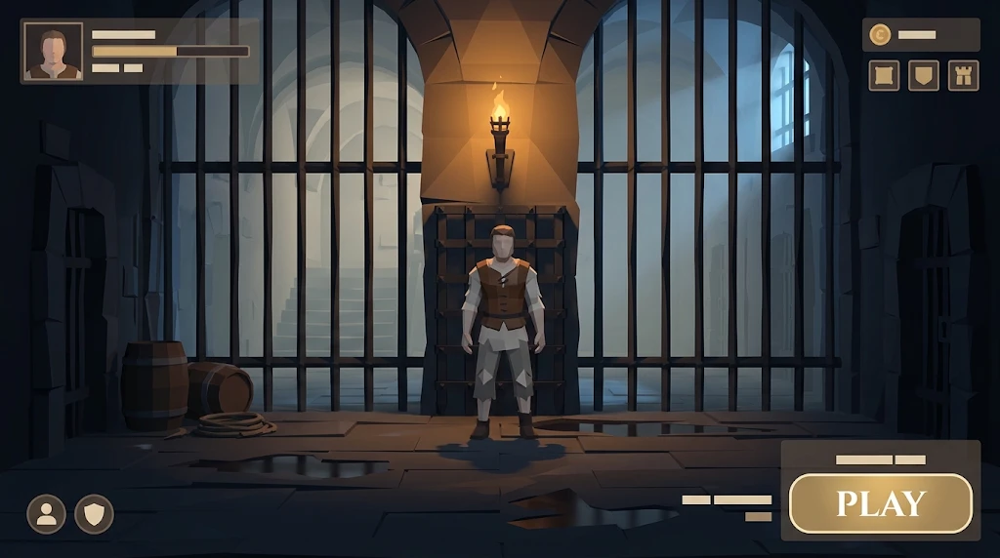
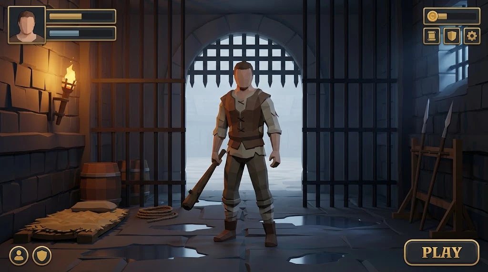
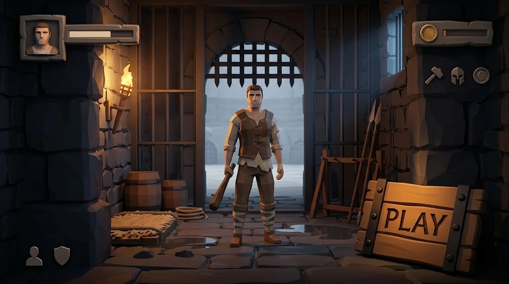

# 23 — Сцена меню і її UI

> Відповідь на «напиши декілька промтів сцени (разом з UI) і подумай що має бути на UI».
> Промти написані за шаблоном, який вижив після двох тестових рендерів у
> [08-arena-art-prompts.md](08-arena-art-prompts.md) — ті самі правила проти
> «намальованого концепт-арту» і проти об'єктів, що висять у повітрі.

## Головна ідея: меню — це клітка

Пітч документа 01 починається так: «Двоє прокидаються в клітках на різних краях арени.
Двері відчиняються.»

Отже меню не має бути абстрактним екраном з кнопками на фоні. **Меню — це той момент до
того, як двері відчинились.** Твій втікач стоїть у своїй клітці, за ґратами видно табір,
двері зачинені. Кнопка PLAY їх відчиняє — і це ж і є перехід у матч, без окремої
заставки.

Що це дає, крім настрою:

* **безкоштовний перехід** — камера їде за спиною втікача крізь двері, матч починається
  з тієї самої фази клітки, яку описує документ 17;
* **вітрина скінів задарма** — єдине, що продається за золото, це косметика (документ 09),
  і вона тут стоїть посеред екрана в зріст, освітлена, повільно обертається;
* **масштаб** — гравець бачить свого бійця поруч із ґратами й ящиками того ж розміру, що
  в матчі, і розуміє пропорції до того, як почне грати.

## Що має бути в UI

За частотою використання, а не за важливістю. 90% сесій — це «відкрив, натиснув PLAY».

### Перший екран

| Елемент | Де | Чому саме так |
|---|---|---|
| **PLAY** | правий нижній кут, найбільша річ на екрані | великий палець правої руки в ландшафті. Усе інше може бути меншим |
| Режим під кнопкою | дрібним під PLAY | документ 01 має два режими, вогнепальний — пізніше. Поки один рядок, не вкладка |
| **Ліга + прогрес** | лівий верхній | документ 09: ліги з MMR. Смужка до наступного рангу — єдине число, по якому гравець розуміє, нащо він грає |
| **Золото** | правий верхній | валюта зліва від кнопки магазину, завжди |
| **Щоденні ×3** | правий верхній, під золотом, значком зі лічильником `1/3` | 40 золота кожне й вони **вчать механікам** (документ 09). Якщо їх не видно — вони не вчать нікого |
| **Втікач** | центр, у повний зріст | він і є магазин |
| Нік + рамка профілю | під бійцем, дрібно | рамка — теж косметика |
| ⚙ Налаштування | лівий нижній, маленька | звук, мова, чутливість, керування |
| 👤 Друзі / приватний матч | лівий нижній поруч | «зберегти сід» з документа 09 живе тут |

### Друга глибина (окремі панелі, не окремі сцени)

* **Магазин** — скіни втікачів, скіни зброї, емоції, графіті, ефекти нокауту, рамки.
  Сітка 3×2, ціни в золоті. Сезонна пропозиція згори.
* **Сезон / бойова пропускна** — 6 тижнів (документ 09), смужка з віхами.
* **Профіль** — історія матчів, статистика, збережені сіди арен.

### Чого на першому екрані бути НЕ має

* **Новин і банерів на пів екрана.** Цикл цієї гри — «ще раз», а не «почитати».
* **Жодної реклами між матчами** — це пряма вимога документа 09.
* **Жодного лутбокса з предметами.** Косметика — сітка з цінником, і все.
* **Жодного екіпірування перед матчем.** Обоє починають з нуля — це перший зі стовпів
  унікальності. Екран «вибери стартовий ніж» ламає гру, навіть якщо ніж однаковий.

### Після матчу

Документ 09 уже задає цей екран і дає йому **6 секунд**, бо довший ламає «ще раз».
Кнопки `[ ЩЕ РАЗ ]` і `[ МЕНЮ ]`, і `ЩЕ РАЗ` — більша.

## Промти сцени

Три правила, без яких виходить не те:

1. **Блок стилю** — інакше модель малює концепт-арт, а не геометрію, яку можна повторити
   в Unity. Той самий блок, що вижив після двох тестових рендерів у документі 08.
2. **UI прямо в кадрі** — це **мокап**, а не фон. Без цього не видно, чи лишилося місце
   під кнопки і чи не губиться боєць за ними.
3. **Середньовіччя** — підземелля замку, а не табір ХХ століття. Це єдина епоха, що
   збігається з тим, чим б'ються: булава, спис, бойовий молот, кольчуга, лати.

```
STYLE BLOCK (до кожного):
stylized low poly, rendered in Blender, flat-shaded faceted geometry,
visible flat polygon facets, hard edges between facets, no smooth shading,
clean silhouettes readable at phone size, 16:9 landscape,
a 1.8 meter tall human for scale,
everything rests on a solid surface, nothing floats in mid-air

UI BLOCK (до кожного — це мокап):
game UI overlaid as flat vector shapes on top of the scene:
bottom right a large rounded rectangle button reading PLAY,
top left a small portrait frame with a horizontal progress bar beside it,
top right a coin icon with a short bar, and under it three small square
icons in a row, bottom left two small circular icons.
UI is flat, semi transparent, warm off-white on dark panels, no readable
paragraphs of text, labels shown as simple light bars.

NEGATIVE (до кожного):
painterly, digital painting, concept art, photorealistic, smooth shading,
noisy textures, garbled text, paragraphs of text, watermarks,
real-world flags, historical insignia, dates, military regalia,
modern objects, barbed wire, electric lights, gore
```

Останні два рядки негативу — не смак: документ 01 вимагає **нуль реальної історичної
символіки**, а «modern objects / barbed wire / electric lights» прибирають табір ХХ
століття, в який модель з'їжджає від слова «prison».

---

### Промт A — «Камера підземелля» (основний) — **v2, після тестового рендеру**



**Що вийшло і варто зберегти:** палітра й розподіл світла — теплий бурштин смолоскипа
проти холодного синього з вікна; фасетна геометрія читається як low poly, а не як
малюнок; ґрати обрамлюють центр і лишають кути вільними; калюжі з відображенням;
бочки й мотузка стоять на підлозі; **UI сів рівно туди, куди просили** — портрет і
смужки зліва вгорі, монета і три щоденні справа вгорі, дві круглі кнопки зліва внизу,
PLAY справа внизу, підписи смужками замість нечитабельного тексту.

**Що зламано і чим лікується:**

| Проблема | Причина | Рядок, що лікує |
|---|---|---|
| **Боєць замалий** — займає ~40% висоти, скін не роздивитись | нема вказівки на розмір у кадрі | `the figure fills 60% of the frame height, knees to head in the lower two thirds` |
| Стоїть **за ґратами**, у прорізі — читається як «чоловік у дверях» | ґрати описані і ліворуч-праворуч, і позаду | `the figure stands IN FRONT of the bars, closer to the camera than any bar` |
| **Пласке світло на фігурі**, він блідо-сірий, а не в бурштині | смолоскип описаний, але не сказано, що він ключове світло саме на бійця | `the torch is the key light ON THE FIGURE, warm amber from above and in front` |
| **Без зброї** — незрозуміло, у що це гра | не просили | `holding a medieval club in his right hand, tip resting on the floor` |
| Смолоскип **прямо над головою** і дрібний | нема позиції | `the torch bracket is on the left wall at head height, not above him` |
| **Порожня нижня третина** — суцільна підлога | камера зависоко | `camera low, at the figure's chest height` |
| **Мертві зони** ліворуч і праворуч від фігури | нема чим зайняти | `a wooden weapon rack against the right wall, a straw pallet on the left` |
| За ґратами **просто склепіння**, не видно, куди ведуть двері | фон описаний як інтер'єр | `beyond the gate a wide arena floor in pale fog, hinting at a larger space` |
| UI **тьмяний**, губиться на тлі | нема контрасту в описі | `UI panels are dark charcoal with a warm gold stroke, clearly readable` |
| Телефон — не 16:9, боки обріжуться | просили 16:9 | `20:9 ultrawide, all important content inside the central 16:9` |

---

#### Рендер v2 і що з ним не так



**Сцена готова.** Боєць великий і попереду ґрат, бурштин з лівого смолоскипа ліпить
його, за опускними ґратами блідий туман арени, стійка зі списами праворуч, солом'яник
і бочки ліворуч, калюжі, низька камера. Цю половину промта більше не чіпаємо.

**UI виглядає накладеним зверху** — і причина не в смаку, а в тому, що кожен елемент
оформлений однаково:

| Проблема | Чому так вийшло | Що робити |
|---|---|---|
| Усе в **однаковій золотій рамці** з однаковим обведенням і радіусом | у промті один опис панелі на всі елементи | різні матеріали для різних ролей: PLAY — дерево з залізом, валюта — латунь, решта — **без рамки взагалі** |
| **Нема ієрархії**: лічильник монет важить стільки ж, скільки PLAY | не сказано, що головне | `PLAY is the single heaviest element; every other element is quiet` |
| Блок зліва вгорі **завеликий**, конкурує з бійцем | дві довгі смужки + велика рамка | `compact, one short bar` |
| Елементи **в самих кутах**, як дебаг-оверлей | нема полів | `inset from every edge by 4% of the frame` |
| **Золото скрізь**, тож акценту не лишилось | один колір на все | золото **тільки** на PLAY і монеті |
| Іконки **нічого не кажуть про цю гру** | generic cog/shield/person | ковальський молот, шолом, монета з карбом |
| UI **нічим не пов'язаний зі сценою** | описаний як плаский оверлей | те саме фасетне затінення, **те саме світло смолоскипа**, тепла тінь збоку |

Головне з цього — останнє. Накладений вигляд лікується не «зробити гарніше», а тим,
щоб UI був **з того самого матеріалу і під тим самим світлом**, що й підземелля.

---

#### Повний промт v3 — той самий кадр, інший UI

```
A stylized low poly medieval dungeon cell seen from inside, 20:9 ultrawide,
all important content inside the central 16:9.

A single escaped prisoner stands in the centre of the frame, facing the
camera, IN FRONT of the bars and closer to the camera than any of them.
He fills 60% of the frame height, knees to head in the lower two thirds.
Torn linen shirt, scuffed leather jerkin, cloth wraps on the shins,
holding a medieval wooden club in his right hand, its tip resting on the
flagstones beside his boot. Weight on one leg, shoulders square, calm.

Camera low, at the figure's chest height, looking very slightly up.

Behind him a heavy shut iron portcullis in a stone arch. Beyond the
portcullis, pale and out of focus, a wide arena floor in cold fog.
Thick iron bars fill the left and right thirds of the frame, nearer the
camera than the arch but further than the figure.

A burning torch in an iron wall bracket on the LEFT wall at head height
is the key light ON THE FIGURE: warm amber from the front left. Cold
blue moonlight from a small barred window high on the right is the fill.

A wooden weapon rack with two spears against the right wall. A straw
pallet and two barrels against the left wall, a coil of rope on the
floor. Damp flagstones with shallow puddles reflecting the torch.
Dark foreground, pale background, three clear depth planes.

THE INTERFACE IS PART OF THE ROOM, NOT A LAYER ON TOP OF IT.
It is built from the same materials as the dungeon, shaded with the same
flat facets, and lit by the same torch from the front left, so every
piece carries a warm edge on its left side and a cool shadow on its right.
Inset from every edge by 4% of the frame. Nothing overlaps the figure.

One element dominates: bottom right, a PLAY button made of a thick oak
plank bound in black iron straps with riveted corners, the word PLAY
burned into the wood, lit by the torch. It is the single heaviest,
brightest and largest piece of interface in the frame.

Everything else is quiet and has NO panel or box behind it:
- top left, a small carved stone plaque with a portrait relief, and
  beside it one short horizontal progress bar inlaid like a groove in
  the stone. Compact, a quarter the size of the PLAY button.
- top right, a single aged brass coin with a struck design, and a short
  bar beside it. Under it, three small flat iron icons in a row with no
  frames: a blacksmith hammer, a helmet, a coin.
- bottom left, two small iron icons with no frames.

Colour discipline: warm off-white for every label and bar. ONE gold
accent, used only on the PLAY button and the coin, nowhere else.
All other interface is dark iron and weathered stone, nearly as dark as
the scene, readable only by its warm lit edge.
Labels as simple light bars, no readable paragraphs of text.
A soft dark gradient along the top and bottom edges of the frame instead
of panels, so the interface sits on shadow rather than on boxes.

stylized low poly, rendered in Blender, flat-shaded faceted geometry,
visible flat polygon facets, hard edges between facets, no smooth shading,
clean silhouettes readable at phone size,
everything rests on a solid surface, nothing floats in mid-air

--no painterly, digital painting, concept art, photorealistic, smooth
shading, noisy textures, garbled text, paragraphs of text, watermarks,
real-world flags, historical insignia, dates, military regalia, modern
objects, barbed wire, electric lights, gore, UI covering the character,
rounded rectangle panels, glassmorphism, drop shadows, uniform gold
outlines on every element, generic mobile game UI kit
```

Останні два рядки негативу — найважливіші в усьому промті. `rounded rectangle panels`
і `uniform gold outlines on every element` — це буквально те, що вийшло в v2, і модель
туди з'їжджає від самого слова «UI».

---

#### Повний промт v2 (попередній)

```
A stylized low poly medieval dungeon cell seen from inside, 20:9 ultrawide,
all important content inside the central 16:9.

A single escaped prisoner stands in the centre of the frame, facing the
camera, IN FRONT of the bars and closer to the camera than any of them.
He fills 60% of the frame height, knees to head in the lower two thirds.
Torn linen shirt, scuffed leather jerkin, cloth wraps on the shins,
holding a medieval wooden club in his right hand, its tip resting on the
flagstones beside his boot. Weight on one leg, shoulders square, calm.

Camera low, at the figure's chest height, looking very slightly up.

Behind him a heavy shut iron portcullis in a stone arch. Beyond the
portcullis, pale and out of focus, a wide arena floor in cold fog,
hinting at a much larger space than this cell.
Thick iron bars fill the left and right thirds of the frame, nearer the
camera than the arch but further than the figure.

A burning torch in an iron wall bracket on the LEFT wall at head height
is the key light ON THE FIGURE: warm amber from the front left, carving
his face and the club out of the dark. Cold blue moonlight from a small
barred window high on the right is the fill, and it never reaches him.

A wooden weapon rack with two spears against the right wall.
A straw pallet and two barrels against the left wall, a coil of rope on
the floor. Everything rests flat on damp flagstones with shallow puddles
that reflect the torch.

Dark foreground, pale background, strong value separation, three clear
depth planes: bars, figure, lit gate.

game UI overlaid as flat vector shapes on top of the scene:
bottom right a large rounded rectangle button reading PLAY in a gold
stroke, top left a square portrait frame with two horizontal progress
bars beside it, top right a coin icon with a short bar and under it
three small square icons in a row, bottom left two small circular icons.
UI panels are dark charcoal with a warm gold stroke, clearly readable
against the scene, no readable paragraphs of text, labels shown as
simple light bars. Nothing overlaps the figure.

stylized low poly, rendered in Blender, flat-shaded faceted geometry,
visible flat polygon facets, hard edges between facets, no smooth shading,
clean silhouettes readable at phone size,
everything rests on a solid surface, nothing floats in mid-air

--no painterly, digital painting, concept art, photorealistic, smooth
shading, noisy textures, garbled text, paragraphs of text, watermarks,
real-world flags, historical insignia, dates, military regalia, modern
objects, barbed wire, electric lights, gore, UI covering the character
```

---

### Промт A — «Камера підземелля» (v1, початковий)

```
A stylized low poly medieval dungeon cell seen from inside, wide landscape view.
Thick iron bars fill the left and right thirds of the frame; the centre is
open flagstone floor with a single escaped prisoner standing on it, facing
the camera, in torn linen and a leather jerkin.
Behind the bars, pale and out of focus: a vaulted stone undercroft with
round arches, a stone staircase, more cell doors along the far wall.
A heavy iron portcullis directly behind the figure, shut.
One burning torch in an iron bracket above him casting a warm amber cone.
Flagstones flat and horizontal, damp, reflecting the torch.
Two wooden barrels and a coil of rope against the left wall, resting on the floor.
Cool blue moonlight from a barred window high on the right, warm torchlight
on the figure. Dark foreground, pale background, strong value separation.
+ STYLE BLOCK
+ UI BLOCK
```

**Чому:** ґрати обрамлюють центр і лишають кути вільними рівно під UI; смолоскип робить
вітрину скіна; опускні ґрати за спиною — те, що відчиняє PLAY.

---

### Промт B — «Двір замку на світанку»

```
A stylized low poly medieval castle bailey at dawn, wide landscape view,
camera at ground level looking slightly up.
In the centre foreground a single escaped prisoner stands on flat wet
cobblestones, full body, facing the camera.
Behind: a stone keep with narrow arrow slits, a round tower on the left,
a timber palisade on the right, a row of shut iron cell doors along the
back wall, a raised portcullis in a stone arch.
Pale cold sky, low horizon, thin ground fog only behind the figure.
Wooden barrels, a hay cart and crates on the ground, each sitting flat.
Warm low sun from the right rim-lighting the figure; everything behind
desaturated grey-green.
+ STYLE BLOCK
+ UI BLOCK
```

**Чому:** більше світу і місце під широку нижню панель. Мінус — бійця видно гірше, ніж у A.

---

### Промт C — «Розріз вежі» (екран режиму / сезону)

```
A stylized low poly cross-section of a three storey medieval stone tower,
sliced open like a doll house, wide landscape view, seen from the side.
Three flat horizontal floors of flagstone connected by visible wooden
ladders and floor hatches.
Iron-bound chests and wooden crates stand on the floors, each resting flat.
Two 1.8 meter human silhouettes on different floors for scale.
Cold grey-green stone palette, pale fog behind the tower only.
Warm amber glow from the chests and from torches on the walls.
The left and right wings have the same number of rooms but different
shapes, not a mirror image.
+ STYLE BLOCK
+ UI BLOCK
```

**Чому:** та сама мова, що в документі 08, тож екран режиму — обіцянка того, що буде в
матчі. Для головного меню фокус на персонажі заслабкий.

---

### Промт D — «Силует» (запасний, найдешевший)

```
A stylized low poly medieval scene, wide landscape view, almost a silhouette.
One escaped prisoner standing in the centre on flat flagstones, lit only
from behind by a tall arched window, so the figure reads as a dark shape
with a bright rim.
Behind: a portcullis and a stone arch as flat dark shapes against pale mist.
Three values only: near black foreground, mid grey figure, pale grey background.
No detail anywhere except the figure's rim light and the torch flame.
+ STYLE BLOCK
+ UI BLOCK
```

**Чому:** якщо часу мало. Три площини й одне світло, працює на слабких телефонах і ніколи
не сперечається з UI.

## За що відповідає кожен елемент



Нижче — специфікація того, що на рендері v3. Для кожного: що це, що всередині, і чому
воно взагалі на першому екрані. «Чому» завжди має документ — екран меню не місце для
елементів, які просто гарно виглядають.

---

### 1. PLAY — дубова дошка, справа внизу

**Єдине, заради чого 90% гравців відкривають гру.**

* **Дія:** стає в чергу матчмейкінгу. Опускні ґрати за бійцем повзуть угору, камера їде
  вперед крізь них, завантаження ховається за цим рухом, і матч починається з фази
  клітки (документ 17).
* **Усередині дошки:** слово PLAY. Під час пошуку те саме місце показує таймер і
  `СКАСУВАТИ` — не окреме вікно: друга кнопка на екрані, де все вирішує одна, це вже дві
  кнопки.
* **Під дошкою, дрібно:** назва режиму. Документ 01 має два режими, вогнепальний —
  пізніше; поки це рядок, а не вкладка.
* **Чому так велико:** документ 09 ставить цикл «ще раз» в основу утримання. Усе інше на
  екрані може бути меншим.

### 2. Кам'яна табличка з портретом — зліва вгорі

**Хто ти і куди рухаєшся.**

* **Портрет:** твій втікач **у тому скіні, який на тобі зараз**. Це єдине місце, де
  косметика показана як обличчя, а не як товар.
* **Смужка 1 — ліга.** MMR і прогрес до наступного рангу (документ 09). Це **єдине
  число, яке пояснює, нащо грати далі**, бо золото не купує силу.
* **Смужка 2 — сезон.** Бойова пропускна, 6 тижнів (документ 09).
* **Дія:** відкриває **Профіль** — історія матчів, статистика, збережені сіди арен,
  сходинка ліги, і лічильник захисту новачка для перших 20 матчів (документ 09 називає
  це ключовим).
* **Розмір:** чверть від PLAY. Вона важлива, але її читають раз на сесію, а не щоразу.

### 3. Латунна монета — справа вгорі

**Скільки в тебе золота.**

* **Усередині:** число. **Не смужка** — смужка означає стелю, а в золота стелі нема; на
  рендері там смужка, і це єдине місце, де мокап бреше про механіку.
* **Дія:** відкриває **Крамницю**.
* **Чому вгорі справа:** валюта завжди поруч із тим, на що витрачається, і ніколи не
  поруч із PLAY, щоб їх не плутали пальцем.

### 4. Три залізні іконки — під монетою

На рендері це молот, шолом і монета, і саме тут іконка каже не те, що має робити кнопка.
Три абстрактні значки читаються як **три різні розділи**, а задумані були як
**три щоденні завдання**.

**Що пропоную замість:**

| | Було на рендері | Має бути | Що всередині |
|---|---|---|---|
| 1 | молот | **Щоденні** — сувій із бейджем `1/3` | три завдання по 40 золота, з галочкою на виконаних. Документ 09: вони **вчать механікам** («відкрий 5 сейфів загадкою», «виграй без зброї T3») |
| 2 | шолом | **Кузня** — молот | крамниця косметики: скіни втікачів, скіни зброї, емоції, графіті, ефекти нокауту, рамки профілю. Сітка 3×2, ціни в золоті |
| 3 | монета | **Сезон** — щит із номером | бойова пропускна: віхи, нагороди, скільки лишилось тижнів |

Три значки лишаються трьома, але кожен веде кудись, а не два з них дублюють сусідні
елементи. Монета під монетою — це та сама кнопка двічі.

### 5. Дві іконки — зліва внизу

На рендері — силует людини і щит. Теж не те.

| | Було | Має бути | Що всередині |
|---|---|---|---|
| 1 | силует людини | **Налаштування** — шестерня | звук окремо для музики й ефектів, мова, чутливість стіка, розкладка керування, обліковий запис |
| 2 | щит | **Друзі / приватний матч** — дві фігури | список друзів, запрошення, і **«зберегти сід»** з документа 09: приватний матч на тій самій арені, «дешева фіча з великою вірусністю» |

Силует людини для налаштувань і щит для друзів — рівно навпаки до того, що ці значки
означають усюди. Шестерня і дві фігури читаються без підпису.

---

### Чого тут свідомо нема

* **Екрана екіпірування.** Обоє починають з нуля — це перший зі стовпів унікальності
  (документ 01). «Вибери стартовий ніж» ламає гру, навіть якщо ніж однаковий у всіх.
  Шолом на рендері небезпечний саме цим: він обіцяє спорядження, якого не буде.
* **Новин і банерів.** Цикл — «ще раз», а не «почитати».
* **Реклами між матчами і лутбоксів з предметами** — пряма заборона документа 09.
* **Другої валюти на першому екрані.** Преміум існує (документ 09), але живе всередині
  крамниці, а не поруч із золотом: дві валюти в шапці — це вже магазин, а не гра.

### Скільки чого видно

| Елемент | Як часто торкаються | Розмір на екрані |
|---|---|---|
| PLAY | щоразу | найбільший, один такий |
| Щоденні | раз на сесію | дрібна іконка + бейдж |
| Крамниця / Кузня | раз на кілька сесій | дрібна іконка |
| Профіль / ліга | раз на сесію, поглядом | табличка, чверть від PLAY |
| Сезон | раз на кілька днів | дрібна іконка |
| Налаштування | раз на тиждень | найдрібніше |
| Друзі | рідко, але це віральність | найдрібніше |

## Туман у меню працює ТІЛЬКИ над терейном

Записано, бо на цьому вже один раз згорів цілий коміт.

`PureVolumetricFog.UpdateTerrainBounds()` будує весь свій об'єм із меж терейна і
закінчується рядком:

```csharp
if (!_hasTerrainBounds)
    return;
```

Немає терейна — **немає туману взагалі**. Не слабкого, не тьмяного: жодного. Помилки
теж немає, ефект просто мовчки нічого не робить, і це найгірший вид поломки.

Звідси три правила для сцени меню:

1. **Терейн у сцені обов'язковий і видаляти його не можна.** Він не залишок з арени, він
   ґрунт цього ефекту.
2. **`Find Active Terrains` лишається ввімкненим.** У списку `terrains` зараз один
   порожній слот `{fileID: 0}` — він виглядає як заповнений список, а не дає нічого, тож
   щойно авто-пошук вимкнуть, туман зникне.
3. **`Horizontal Padding` не можна зменшувати під розмір кімнати.** Об'єм це межі терейна
   **плюс** цей відступ, а терейн стоїть збоку від камери: з відступом 8 м кімната
   опиняється поза власним туманом. Тримати 40.

Ще дві цифри компонент тихо обрізає, тож у файлі може стояти одне, а працювати інше:
`targetStepLength` має `Min(2)`, `density` має `Range(0, 0.3)`.

`docs/refs/menu_check.py` перевіряє все це поза Unity — і зеленіє тільки тоді, коли туману
справді є з чого будуватись.

### Дрібниця щодо розміщення

Терейн стоїть у `(-7.57, -0.95, +1.74)`, а кімната займає `z -3.2 … +1.5`. Терейн в Unity
росте від свого початку у **+x і +z** і ніколи в мінус, тож **кімната лежить за його
краєм по z**. Туман до неї дістає лише завдяки відступу в 40 м, а висота ґрунтового шару
під кімнатою береться з краю терейна, а не з-під неї.

Працює, але `Ground Fog Height` при цьому означає не те, що написано. Якщо зсунути терейн
так, щоб кімната опинилась над ним (початок приблизно в `x -20, z -20`), число почне
значити свою висоту над підлогою камери.

## Повний розбір сцени меню

Зроблено за станом сцени, не на око: прочитані її налаштування, камера, світло, URP-ассети.

### Що вже добре

Кімната складена, пропорції правильні (4.0 × ~2.5 × 5 м), камера на висоті грудей,
туман має з чого будуватись, два світла стоять, реквізит на підлозі. Геометрія і
композиція — готові.

### Що знайдено, за силою впливу

**1. Пост-обробка була вимкнена. Це найбільша втрата з усіх.**

У камери стояло `m_RenderPostProcessing: 0`, а в сцені не було жодного Volume. Отже:

* **немає тонмапінгу** — а `m_SupportsHDR: 1`, тож усе, що яскравіше за 1, зрізалось у
  чистий білий. Це та сама причина, через яку раніше світіння рідкості виходило білим;
* **немає блуму** — полум'я смолоскипа і туман не світяться, а мають тверді краї. Факел
  без блуму в темній кімнаті виглядає як помаранчевий трикутник;
* немає віньєтки, немає корекції кольору, немає згладжування на жорстких low-poly краях.

Додано `Settings/Menu_PostProcess.asset` і `Global Volume` у сцені: Tonemapping
**Neutral**, Bloom (поріг 0.85, сила 0.9), Vignette 0.3, Color Adjustments
(+0.2 EV, +12 контрасту, +6 насиченості). На камері ввімкнено пост-обробку і FXAA.
Профіль **окремий** від арени, щоб не чіпати бій.

**2. На мобільному ассеті додаткові світла не кидають тіней.**

`Mobile_RPAsset`: `m_AdditionalLightShadowsSupported: 0`, `m_SoftShadowsSupported: 0`.
Тобто **смолоскип на телефоні не кидає жодної тіні** — а тінь від ґрат і є те, що робить
факел факелом. На `PC_RPAsset` вони ввімкнені, тож у редакторі все добре, а на пристрої
картинка інша.

Варіанти: увімкнути тіні додаткових світел на мобільному (коштує), або лишити як є і
покласти всю тіньову роботу на Directional, підкрутивши його напрямок так, щоб ґрати
кидали смуги.

**3. У кімнати немає стелі.**

Світло і небо ллються згори, і Directional конкурує зі смолоскипом. Темна стеля (бодай
площина) зробить факел головним джерелом, а це вся суть кадру.

**4. Камера дивиться вниз на 15°.**

`m_LocalRotation` дає нахил униз ≈14.9°, тоді як промт просив «ледь угору». Через це в
кадрі багато підлоги, і фігура здається нижчою.

**5. Терейн не під кімнатою.**

Деталі вище, у розділі про туман: кімната лежить за краєм терейна по z.

**6. Немає Reflection Probe.**

В інтер'єрі URP без пробу все дзеркальне відбиває скайбокс. Один бокс-проб на кімнату
прибере «пластикові» відблиски з каменю.

### Чого НЕ треба купувати: факел уже є

У проєкті **два** факели:

* `Dungeon Pack V.1.1/DungeonPack/Prefabs/Hanging Torch.prefab` — меш **плюс
  ParticleSystem**, тобто вже оживлений, готовий до перетягування;
* `Updated Modular Dungeon - May 2019/FBX/Torch.fbx` і `Woodfire.fbx` (Quaternius, CC0) —
  меші без вогню.

І три готові полум'я з Polyart: `PF_FireSmall`, `P_Fire`, `P_CandleFlame`.

Отже найкоротший шлях: взяти `Hanging Torch`, повісити на ліву стіну на висоті голови і
**зробити `Torch Key` його дитиною**, щоб світло й полум'я були одним об'єктом.

## Як збирати в Unity

Меню — **окрема сцена**, і її UI авторений у ній, а не створений у рантаймі: це та сама
вимога, що й для всього іншого в цьому проєкті (усе має бути видно в інспекторі).
Правило «рантайм UI не додавати» стосувалося HUD у матчі — меню це не скасовує, воно
просто мусить бути зібране руками в сцені.

Практично:

1. Сцена `Menu`, камера нерухома, один Canvas у Screen Space - Camera.
2. Втікач — той самий префаб, що в матчі, з тим самим `GR_Player` аніматором, але без
   `PlayerController`: тільки Animator на idle-клипі. Так скін одразу видно в тій самій
   позі, в якій його побачать у бою.
3. Фон — **геометрія**, не картинка: промт дає референс, а не ассет. Інакше він не
   працюватиме на інших співвідношеннях сторін телефонів.
4. Освітлення — те саме `SceneLighting`, що й в арені, щоб скін у меню і скін у бою були
   одного кольору. Скін, який у магазині яскравіший, ніж у грі, — це скарга у відгуках.
5. Перехід у матч: ворота з'їжджають, камера рушає вперед, завантаження ховається за цим
   рухом.

## Факели: що насправді було не так

Скарга була «факели просто як обʼєкти». Перше, що показав вимір, — вони **не** голі
палиці. `Torch.fbx` має **два** матеріали, `DarkMetal` і `Fire`, і другий — це конус
полумʼя з 24 полігонів заввишки 0.21 м у чашці. Вогонь у моделі вже був.

Бракувало трьох речей, і саме в такому порядку важливості:

1. **конус не світиться.** Матеріал `Fire` згенерований імпортером і лежить **усередині**
   `Torch.fbx`, тому редагувати його неможливо; і емісію не можна увімкнути ззовні —
   `_EMISSION` вшитий у матеріал, а `MaterialPropertyBlock` не вмикає ключові слова
   шейдера. Це вже коштувало одного коміту на світінні луту. Тому тул підставляє **наш**
   матеріал у слот `Fire`, а слот шукає **за назвою**, ніколи за індексом — індекс тут
   випадково 1, і типізований у тулі індекс — це баг, який чекає на переекспорт моделі.
2. **нічого не рухається.** `PF_FireSmall` з Polyart, масштаб 0.22 — приблизно розмір
   власного конуса факела; більше, і частинки зʼїдають сам факел.
3. **на стіну нічого не падає.** Вогонь без плями світла, що тремтить поруч, читається як
   наклейка.

### Чому світло отримують три факели з шести

Обидва pipeline-ассети тримають `m_AdditionalLightsPerObjectLimit: 4`. Шість світел на
факелах плюс `Gate Fill` — це сім, а понад ліміт URP **мовчки викидає зайві, по обʼєкту і
по кадру**, тож пʼяте світло в одній кімнаті виглядає не як пʼяте світло, а як мерехтіння
інших чотирьох. Три плюс `Gate Fill` — рівно чотири, і не викидається нічого.

Які саме три — виміряно, а не обрано. Правило: **у кадрі важливіше за поза кадром, далі
ближче до бійця важливіше за далі.** На камері меню (поз. `-0.498, 1.15, -2.22`, нахил
14.9° вниз, FOV 60 по вертикалі) з шести факелів у кадр потрапляють **лише два** — ті, що
біля арки, на `ndc x = ±0.72` при 16:9. Решта чотири стоять збоку й позаду камери: у
портреті в кадрі немає жодного, у ландшафті — тільки ці два. Третім іде `Torch (2)`:
1.94 м до бійця, найближчий з тих, що поза кадром, і **єдиний із трьох, що стоїть перед
ним** — тому саме він ключове світло, а не контровий обвід.

### `Torch Key` прибрано

Стенд-ін лампа висіла в повітрі за метр від найближчого факела і в сцені була
**вимкнена** (`m_IsActive: 0`) — тобто теплого світла в меню не було взагалі, звідси і
«сцена занадто темна». Тепер світло має джерело, і четверта тепла лампа все одно вивела б
підлогу за ліміт.

### Дрібниці, які коштували б вечора

* `PF_FireSmall` має **чотири** системи частинок на `scalingMode: Local` — кожна читає
  власний трансформ і **ігнорує батьківський**, тож масштабування кореня префаба розсуває
  шари, не зменшуючи жодного. Тул і сцена переводять усі чотири на `Hierarchy`, щоб одна
  ручка масштабу означала одну річ.
* Факели стоять з масштабом **40** (fbx у сантиметрах, виставлені на око), тому одна
  локальна одиниця під факелом — це сорок метрів. `Torch Fire` гасить це масштабом 1/40, і
  все під ним — у метрах. `TorchLight` ділить свій `drift` на `lossyScale` батька з тієї
  ж причини: без цього дрейф 0.015 кинув би світло на 0.6 м через кімнату.
* Обʼєкт, доданий **під префаб-інстанс**, має бути записаний у `m_AddedGameObjects` цього
  інстансу. Одного `m_Father` досить, щоб він малювався на місці, і недосить, щоб Unity
  його зберегла: при першій звірці префаба він опиниться в корені сцени. Без попередження.
  `scene_check` тепер це ловить.
* Модель Z-up: шахта факела йде вздовж локального **+Z**, а не +Y. Це видно з того, що всі
  інші пропи Quaternius у цій сцені поставлені з поворотом −90° по X.

### Що перевіряється

`menu_check` рахує додаткові світла проти ліміту пайплайна, звіряє кількість факелів із
кількістю вогнів на них і сварить за `Light` на `Torch Fire` без `TorchLight` — бо
нерухоме світло на рухомому полумʼї і є те, через що вони читалися як пропи.

На телефоні `Mobile_RPAsset` має `m_AdditionalLightShadowsSupported: 0`, тож мʼяка тінь
ключового факела — це прев'ю в редакторі й на ПК, не на пристрої.

## Другий прохід по сцені: що виміряно і що виправлено

### Голова бійця була за межами кадру

Стікмен — 1.795 м (вершини fbx 0 … 179.528 при UnitScaleFactor 1, тобто сантиметри),
поставлений на y = 0.026, отже маківка на **1.82 м**. Камера: (−0.498, 1.15, −2.22),
нахил **14.92°** вниз, FOV 60 по вертикалі. Проєкція маківки:

```
ndc y = +1.151      (+1.0 — верхня межа кадру)
```

Тобто голову **зрізало**. У Scene View цього не видно — видно тільки в Game View.

Але просто підняти камеру не можна було, і ось чому мій попередній висновок «камера
дивиться вниз на 15°, а промт просив ледь угору» був неповним. Стіни — пʼять рядів по
0.4845 м від y = 0.01, тобто камінь закінчується на **2.43 м**. Верх дальньої стіни
проєктується на ndc +1.085 — рівно за верхньою межею. **Нахил тримав відсутню стелю поза
кадром.** Звідси порядок: спершу стеля, потім камера.

| нахил | маківка | ступні | верх стіни |
|------:|--------:|-------:|-----------:|
| 14.92° | **+1.151** | −0.453 | +1.085 |
| 12° | +1.028 | −0.549 | +0.966 |
| **8°** | **+0.871** | **−0.685** | +0.813 |
| 0° | +0.586 | −0.983 | +0.535 |

Обрано **8°**: голова в кадрі із запасом, ступні в кадрі, а те, що відкрилося над стіною,
тепер стеля. Низ кадру під ступнями — це місце для UI, як на мокапі.

### Стеля

Плита 4.8 × 0.2 × 6.6 м, низ на 2.43 м, матеріал — **той самий `Stone.mat`**, що й у стін.
Матеріал виявився **без текстур узагалі** (`_BaseMap` порожній, тільки колір), тому куб
збігається зі стінами точно і розтягувати нема чого.

Побічний ефект, і він головний: стеля **перекриває Directional**, тож ключовим світлом
стає факел — те, заради чого все й робилося. Темніше не стане: до цього комміту теплого
світла в меню не було взагалі (`Torch Key` був вимкнений), а тепер його три джерела.

### Терейн під кімнатою

Був на (−7.57, −0.95, **1.74**) розміром 52 × 48 м, а кімната лежить на z від −4.7 до
+2.0 — тобто **повністю за краєм терейна по z**. Туман працював лише тому, що обʼєм — це
межі терейна **плюс 40 м падінгу**. Переставлено на (−26.3, −0.95, −25), щоб обʼєм був
навколо того, що він туманить, а `Ground Fog Height` міряв від підлоги, а не від краю.

### Боєць більше не в Т-позі і не тікає з місця

У сцені стоїть `Player 1.prefab` — бойовий префаб. Він наполовину працює, і це найгірший
варіант:

* у редакторі Animator не програє нічого, тож модель стоїть у bind-позі — **це і є та
  синя Т-поза на скріні**;
* на Play `PlayerController.Update()` тікає мотор **без `MatchState`** і потім пише
  `transform.position` з симуляції, яка не стартувала, — боєць іде з того місця, куди його
  поставили, а в консоль сиплеться «input has been locked».

Виправлено: девʼять бойових компонентів (`PlayerController`, `PlayerAnimator`,
`PlayerInputRouter`, `DeviceInputSource`, `TouchInputSource`, `NoiseListener`,
`PlayerLoadoutView`, `FighterDamageView`, `SirenView`) **вимкнені оверрайдами на інстансі**
— сам префаб не чіпали, в арені нічого не змінилось, — і доданий `MenuFighter` з
`poseState: Idle`.

`MenuFighter` тепер `[ExecuteAlways]`: позує **і в редакторі**. `Animator.Play` лише ставить
стан у чергу, а в едит-моді оновлення нема, тому після нього викликається `animator.Update(0)`.
Хитання (`Sway`) в едит-моді свідомо не працює — воно писало б поворот щокадру, і сцена
була б вічно «змінена».

`MenuSceneSetup` навчений цього випадку: раніше він **пропускав** будь-який Animator під
`PlayerController` і на цій сцені не знаходив нічого.

### Від чого відмовився: Reflection Probe

У попередньому розборі я написав, що без проба все дзеркальне відбиває скайбокс. Перевірив:
скайбокс тут — `FS003_Night_Moonless.mat`, тобто відбиття і так темне, а `_Smoothness`
каменю 0.31. Виграш малий, а компонент довелося б писати руками. Не робив.

### Що тепер перевіряється додатково

`menu_check` читає **крізь префаб**: `PlayerController` у сцені меню існує не як обʼєкт, а
як оверрайд на інстансі, тож перевірка самої сцени нічого не знаходить і пропускає зламану
сцену. Тепер вона відкриває префаб-джерело, знаходить у ньому компонент і дивиться, чи є на
інстансі `m_Enabled: 0`. Плюс сварить за відсутній `MenuFighter`.

## Третій прохід: промінь, вихід і далека площина

### Стеля задушила туман — і це була моя регресія

`PureVolumetricFog` має поле `directionalLight` і `sunStrength`/`sunScattering`. Полів для
точкових світел у компоненті **нема взагалі**: він розсіює **одне** світло — цей
Directional. А `useUnityRealtimeShadows: 1`, тож суцільна стеля, яку я поставив минулим
проходом, почала кидати тінь у туман, і серпанок у кімнаті лишився з самим
`ambientColor × ambientStrength`. Пласко.

Виправлено **прорізом**, а не скасуванням стелі. Сонце йде напрямком
(−0.321, −0.766, 0.557) (euler 50, −30). Від стелі на 2.43 м до підлоги промінь
зсувається на `dz = +1.766`, `dx = −1.020`. Отже проріз на `z ∈ [−0.60, −0.05]` дає:

* на висоті маківки (1.82 м) промінь іде по `z ∈ [−0.16, +0.39]` — боєць стоїть на
  `z = −0.24`, тобто **холодний контровий по потилиці й плечах**, якраз навпроти теплого
  факела спереду;
* на підлогу лягає пляма `z ∈ [1.17, 1.72]` — це рівно бочка, відро, череп і монети
  (`z ≈ 1.23…1.30`) під прапорами (`z = 1.46`).

Сам проріз у кадр не потрапляє: стеля стає видимою лише з `z = 0.95`, а проріз
закінчується на `−0.05`. Видно промінь і освітлений реквізит, а не дірку в стелі.

`nearFadeDistance` опущено 3.2 → **2.2**: туман має починатись одразу за бійцем, інакше
нижня половина променя йде крізь чисте повітря. Формулу в `MenuLightingSetup` змінено з
`depth * 0.85` на `depth * 0.5`, щоб повторний запуск тула не повернув як було.

### Камера їхала в стіну

`MenuDirector` вів камеру вздовж `view.transform.forward` на `walkDistance = 5` м. Але
арка з ґратами (`Arch_bars`, `z = −4.60`) стоїть **позаду камери**: кадр дивиться вздовж
камери на вбрану дальню стіну (`z ≈ 1.96`, прапори й реквізит), а вихід — на іншому кінці.
П'ять метрів уперед — це п'ять метрів у стіну, до якої чотири.

Тепер напрямок береться **до воріт**, а не з камери: `Leaving()` рахує
`gate.position − camera.position`, сплощує по y і нормалізує. Камера **не повертається** —
виїзд задом наперед під аркою, обличчям до кімнати, читається як «тебе виводять», що для
гулагу і треба, і не коштує жодної анімації.

`MenuSceneSetup` тепер шукає спершу `Arch_bars` (піднімаються саме ґрати, а не кам'яна
кладка навколо) і пише в лог, попереду чи позаду камери опинились ворота.

### Далека площина 1000 → 60

Туман реконструює світову позицію з буфера глибини (`useSceneDepth: 1`), а точність
глибини розподілена як 1/z між near і far. При far = 1000 майже вся точність витрачена на
порожнечу. Кімната — 7 м, найдальший кут терейна — 36 м, `maximumFogDistance` — 40, тож 60
покриває все з запасом і помітно піднімає точність там, де туман реально є.

### Гардероб бійця

`MenuFighter.weapons` / `armour` заповнюються **копією масивів з `PlayerLoadoutView`**, що
вже висить на цьому ж префабі з усіма 12 зброями, прив'язаними до `ItemId`. Не збирається
заново: другий список — це другий список, який треба тримати в синхроні. Нічого не
вибирається автоматично — порожня рука це нормальний стан меню, а вибирати комусь меч не
справа тула. Сенс у тому, щоб у випадайці були пункти.

### Що тепер перевіряється

* `directionalLight` у тумані має бути заповнений і світло ввімкнене — інакше серпанок
  тихо стає пласким ambient-кольором;
* `far clip plane` камери має бути не менший за `maximumFogDistance` — інакше туман
  мовчки закінчується на далекій площині.

### Що лишилось на твій вибір

1. **MSAA вимкнена** (`m_MSAA: 1`) на обох pipeline-ассетах, а на мобільному ще й
   `m_RenderScale: 0.8`. Для low-poly з жорсткими силуетами MSAA 4x — найбільший приріст
   якості картинки, і на тайлових мобільних GPU він дешевий. Але це глобальна настройка,
   вона вплине й на арену, тому сам не вмикав.
2. **240 префаб-інстансів, усі з `m_StaticEditorFlags: 0`.** SRP Batcher увімкнений, тож
   вартість одного виклику мала, але викликів все одно 240. `Batching Static` (флаг 4)
   звів би їх до десятка. Не робив: виграш невидимий, а оверрайди треба ставити ще й на
   дочірні обʼєкти fbx-префабів.
3. **Тіні додаткових світел на мобільному** (`m_AdditionalLightShadowsSupported: 0`) — те
   саме питання ціни, і те саме: глобально.
4. **UI в сцені ще нема** — Canvas відсутній. `MenuUI` чекає, кнопки підключаються до
   `Play / Profile / Shop / Dailies / Season / Settings / Friends / Back`.

## Усі інші екрани

Повний набір промтів на всі одинадцять екранів гри — головне меню, магазин, щоденні,
сезон, профіль, налаштування, друзі, завантаження, HUD, фазові сповіщення, екран після
матчу — лежить у [26](26-ui-screens-and-prompts.md). Там же записаний спільний стиль і
список того, чого в наборі немає навмисно.

Два промти нижче лишаються тут як історія ітерації: промт меню v3 ще в «меблевому»
стилі з дубовою дошкою, який потім скасував прийнятий мокап HUD.

## HUD бою: фінальна розкладка, п'ять слотів

Мокап HUD, який прийняли, мав **три** квадрати спорядження, бо в симуляції їх було три.
Спорядження в грі — це шолом, зброя, броня, пояс і утиліта, тобто п'ять
([02](02-combat-and-controls.md#слоти)), тож квадратів теж п'ять. Разом із цим силует
зменшений: його робота — підписати, який квадрат до якого місця на тілі, а не бути
картинкою.

Порядок квадратів читається зверху вниз по тілу, а не зліва направо:

```
        ○ ШОЛОМ            (голова)
   ЗБРОЯ ●   ● БРОНЯ       (рука / груди)
        ○ ПОЯС             (пояс)
        ○ УТИЛІТА          (сумка на поясі)
```

Порожній слот — тонкий контур квадрата, заповнений — предмет усередині з обведенням
кольору рідкості. Нуль цифр, нуль назв: за тіром видно, чого воно варте, за силуетом — що це.

**Кольори рідкості — ті самі, що в самій грі**, і не «білий / синій / золотий», як було в
першій версії промта: `ItemModels.DefaultPalette()` дає **зелений (common) / синій (rare) /
фіолетовий (legendary)**. Три відтінки, які ніхто не переплутає на телефоні, і жоден з них
не збігається з холодним сіро-зеленим туманом арени. Обведення слота ще й **світиться**
своїм кольором — м'яке гало назовні на 2–3 пікселі, без пульсації: в HUD пульсує тільки те,
що вимагає дії, а слот нічого не вимагає. Сила гало йде за тіром: common майже не світиться
(це база, і якщо кричить усе — не кричить ніщо), rare помітно, legendary найяскравіше.

Вісім елементів HUD і не більше, як вимагає docs/02: дві смуги HP, заряди стаміни,
годинник, колонка спорядження, джойстик, кнопки праворуч, індикатор напрямку звуку.

### Промт — фінальний HUD (v4: п'ять слотів, менший силует)

```
A gameplay screenshot of a mobile 3D side-view fighting game, 20:9
ultrawide phone screen held horizontally, all important content inside
the central 16:9.

THE GAME FIRST. This is a real frame of play, not a UI illustration.

A cutaway through a stone dungeon, seen strictly from the side like a
doll's house with the front wall removed. Three floors stacked directly
above each other, connected by wooden ladders. Narrow perspective, about
a 30 degree field of view, camera tilted down by 12 degrees, so the
floors have thickness and nothing is distorted.

On the middle floor, two lean fighters face each other on the same flat
line, mid-exchange, about two metres apart. Each is 18% of the screen
height. The LEFT fighter is rimmed in cold cyan, barefoot, bare-headed,
swinging a wooden club. The RIGHT fighter is rimmed in warm orange, in a
mail coif and chainmail with a rope belt, guard raised. Both read as
clean silhouettes first: the weapon's shape alone says what it is.

The background is desaturated cold grey stone, slightly out of focus.
Everything interactive is saturated and glows faintly: a wooden crate on
the floor above, a dagger lying on the floor below in a soft white
halo, a ladder in warm wood. Low poly, flat faceted shading, no
textures, no text anywhere in the world.

THE INTERFACE IS A THIN LIGHT OVERLAY, NOT FURNITURE.
No wooden planks, no iron straps, no stone slabs, no rounded panel
boxes, no frames behind anything. Every element is made of thin 2px
lines, flat silhouettes and bare glyphs over the game, inset from every
edge by 4% of the frame. Nothing overlaps the two fighters.

TOP EDGE, one quiet row:
  far left, a horizontal health bar in cold cyan, a thin unfilled
  outline behind it, no number;
  under it, four small cyan diamonds in a row, three lit, one dim:
  stamina charges;
  far right, the same mirrored in warm orange for the other fighter;
  dead centre, the round clock as thin white digits, 1:24, small, with
  no box around it.

LEFT EDGE, lower third: a floating virtual joystick, just two thin white
circles, a large ring and a small filled dot pushed to its upper right.
Barely there, 60% opacity.

RIGHT EDGE, lower third: four round buttons as thin white outlines, no
fill, no panel, arranged in a cluster for the right thumb:
  the largest, lowest right, a crossed-swords glyph: ATTACK;
  above it, a smaller circle with a shield glyph: BLOCK;
  to their left, a smaller circle with an open-hand glyph: ACTION;
  above that, the smallest circle with a single up arrow: JUMP.

LEFT EDGE, middle, the EQUIPMENT COLUMN: a small human figure drawn in
thin white line art only, a wire mannequin, no fill, no face, only 22%
of the screen height, standing upright. Five small square outlined slots
are placed around it, each joined to the body by a short thin leader
line:
  one above the head: a mail coif, outlined in BLUE;
  one at the right hand: a club, outlined in GREEN;
  one at the chest: chainmail, outlined in BLUE;
  one at the waist: a rope belt, outlined in GREEN;
  one just below the waist: an empty slot, a bare thin grey square
  outline with nothing in it.
Each filled slot holds a tiny flat icon of the item and nothing else:
no numbers, no names, no bars.

The rarity outline is the only coloured thing in the whole interface and
it GLOWS: a soft halo of its own colour bleeding 2 to 3 pixels outward
from the square, brightest on the blue slots, barely there on the green
ones, and none at all on the empty grey one. Green is a common find,
blue is rare, violet would be legendary. The glow is soft and even, not
a hard neon stroke, not a lens flare, and it does not light anything
around it.

LOWER LEFT, above the joystick: the sound direction indicator, a thin
white arc segment pointing up and to the left, fading at its ends, with
a small chest glyph at its tip: something was opened on the floor above,
off screen.

Palette: cold grey stone, cyan for player one, orange for player two,
warm wood only where the world is interactive. The interface is white at
80% opacity and nothing else.

Crisp, readable at phone size, clean flat vector interface over low poly
3D, no photoreal materials, no drop shadows, no gradients in the UI.
```

Негатив: `wooden UI panels, stone UI frames, iron rivets, ornate borders,
rounded rectangle panels behind icons, large portrait of the character, inventory
grid, numbers over health bars, damage numbers, item names, tooltips, minimap,
isometric or three-quarter camera, text in the world, neon glow on every UI
element, glowing buttons, glowing health bars, lens flare`.

Останні чотири — нові й важливі: світитись має **тільки** обведення рідкості. Щойно
засвітяться ще й кнопки й смуги HP, рідкість перестає щось означати.
